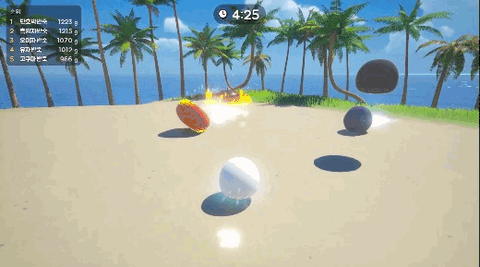
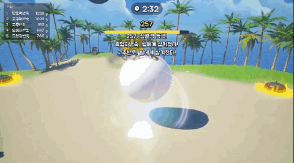
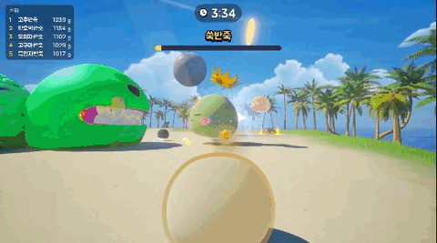

<h1 align="center">찹쌀킹 UE</h1>

<p align="center">
  
  
  
</p>

<p align="center">
  <b>Unreal Engine 5.6과 C++로 혼자 만든</b> 봇 대전 액션 게임입니다.<br>
  <a href="https://quixotic-alyssum-73e.notion.site/3f1c75a04ed3818eb56ef46777855647">노션에서 자세히 보기 →</a>
</p>

| | |
|---|---|
| 기간 | 2026.05 – 진행 중 |
| 인원 | 1인 (기획 · 프로그래밍 · 모델링) |
| 엔진 · 언어 | Unreal Engine 5.6 · C++ (Blueprint는 에셋 연결용) |
| 규모 | C++ 234파일 · 약 25,900줄 |
| 성과 | 2026 콘텐츠 창의인재동반사업 선정 |

## 게임 규칙 한눈에

- 5분 동안 몸집(질량)을 키우는 게 점수입니다. 반죽끼리 재료를 쏘아 서로의 몸집을 떨어뜨립니다.
- 하늘에서 복주머니가 떨어지고, 재료 · 폭탄 · 절구공이가 나옵니다.
- 절구공이를 든 채 널뛰기판에 오르면 달의 절구로 날아가 **찹쌀킹**이 되고, 다른 반죽을 먹을 수 있습니다.
- 먹힌 반죽은 좌우로 몸부림쳐 탈출하고, 모든 상대가 킹에게 붙으면 킹이 이깁니다.

## 코드 읽는 순서

`ChapSalKing/Source/ChapSalKing/` 기준입니다.

| 순서 | 파일 | 무엇을 하는지 |
|---|---|---|
| 1 | [`Private/Framework/CSKGameMode.cpp`](ChapSalKing/Source/ChapSalKing/Private/Framework/CSKGameMode.cpp) | 매치 흐름 — 봇 스폰, 복주머니 · 절구공이 웨이브, 두 가지 종료 조건(시간 · 킹 포획) |
| 2 | [`Private/Player/CSKPlayerCharacter.cpp`](ChapSalKing/Source/ChapSalKing/Private/Player/CSKPlayerCharacter.cpp) | 캐릭터는 얇게, 기능은 `Player/Components/`의 컴포넌트 14개로 나눈 구조의 중심 |
| 3 | [`Private/Player/Components/CSKChapSalKingComponent.cpp`](ChapSalKing/Source/ChapSalKing/Private/Player/Components/CSKChapSalKingComponent.cpp) | 킹 변신 · 먹기 — 스윕 → 전방 필터 → 점수 정렬로 대상 선택, 질량 빼앗기 |
| 4 | [`Private/Player/Components/CSKEatableComponent.cpp`](ChapSalKing/Source/ChapSalKing/Private/Player/Components/CSKEatableComponent.cpp) | 먹히는 쪽 상태 머신(입으로 끌려감 → 배 속 → 몸에 붙음) · 몸부림 게이지 |
| 5 | [`Private/AI/BTServices/BTService_SelectBotObjective.cpp`](ChapSalKing/Source/ChapSalKing/Private/AI/BTServices/BTService_SelectBotObjective.cpp) | 봇의 목표 선택 — 판단은 BT 서비스, 실행은 Blackboard 값으로 분리 |
| 6 | [`Public/Combat/ShotEffects/CSKShotEffect.h`](ChapSalKing/Source/ChapSalKing/Public/Combat/ShotEffects/CSKShotEffect.h) | 피격 효과를 `EditInlineNew` 객체로 만들어 재료 데이터에서 조합 |

수치는 대부분 C++에 하드코딩하지 않고 DataAsset(`CSKPlayerStatData`, `CSKProjectSettingsData` 등)으로 뺐습니다.

## 폴더

```
ChapSalKing/Source/ChapSalKing/
├─ Framework/   GameMode · GameState · PlayerController · GameInstance
├─ Player/      캐릭터 + Components/(이동 · 몸집 · 사격 · 킹 · 먹힘 · 소프트바디 …)
├─ AI/          봇 AIController + BTServices/
├─ Combat/      발사체 · 전투 인터페이스 · ShotEffects/
├─ Props/       복주머니 · 절구/널뛰기 · 가마솥 · 뱀 · 장판(꿀 · 연막 · 팥벽)
├─ Camera/      카메라 셰이크 서브시스템
└─ UI/          HUD · 메뉴 위젯
tools/          에디터 없이 UI 스타일을 적용하는 Python 파이프라인 · 인트로 에셋 생성
```

## 이 저장소에 없는 것

- **에셋(Content)과 플러그인은 포함하지 않았습니다.** 코드를 읽기 위한 공개본이라 이 저장소만으로는 빌드 · 실행되지 않습니다.
- 사용 플러그인: [KawaiiPhysics](https://github.com/pafuhana1213/KawaiiPhysics) (흔들림 물리)
- 개발 이력은 비공개 저장소에 있습니다.


---

© 2026 김민우. All rights reserved. 열람용으로 공개한 저장소입니다.
